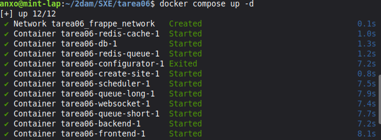
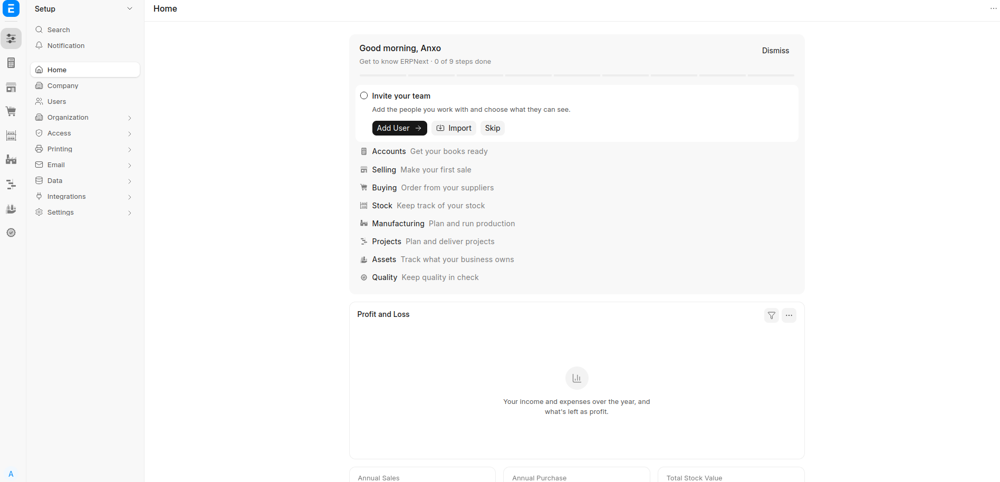
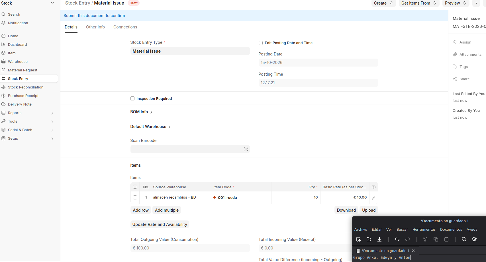
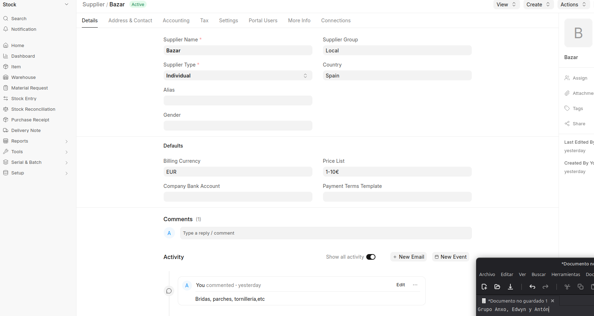
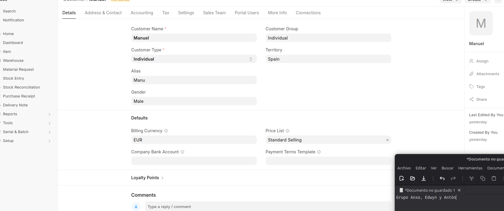
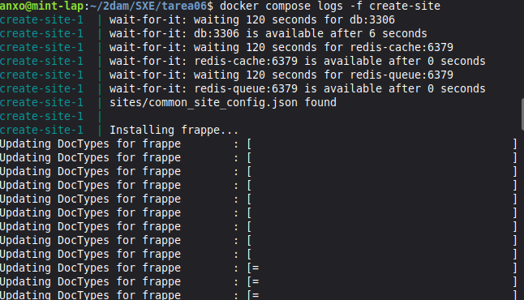

# Tarea 6 - Propuesta de solución de gestión

## Integrantes 

- Anxo Vázquez 

- Antón Seoane

- Edwyn Lezama

## Sistema escogido

El sistema escogido para este proyecto que más se amolda a las necesidades del escenario elegido es `ERP NEXT`.


## Escenario

- Bicis Damián

## Despliegue

> Para información más detallada mira la carpeta `Docs`

Utilizamos el archivo `pwd.yml` del repositorio de `frappe-docker` y modificamos únicamente los atributos que están en el `.env.example` para que los recoja por variables de entorno.

Después de tener nuestro archivo `.env` y el `compose.yml` actualizado lo desplegamos con `docker compose up -d`.

```
source .env

docker compose up -d

docker compose logs -f create-site # mira los logs del contenedor encargado de crear el sitio y esperamos a que finalice

```



Después accedemos a `localhost:8080` en un navegador web y creamos nuestro primer sitio.



## Objetivos

### Inventario

Para crear un inventario primero hay que crear los productos y el almacén, para ello accedemos a la sección `Item` y creamos un nuevo producto llamado `Rueda` con id `001`, para el Almacén lo creamos en la sección `Warehouse`, una vez terminamos de crear el producto y el almacén accedemos a la sección `Stock Entry` y creamos una entrada de la siguiente forma:



### Proveedores

Para crear un proveedor accedemos a la sección `Supplier` y en este caso creamos un Bazar Chino.



### Clientes

Para crear una ficha de cliente entramos a la sección `Customer list`:



## Incidencias encontradas

### Despliegue

En el momento de despliegue docker compose no era capaz de levantar la app, debido a este bloqueo decidimos volver a intentarlo al día siguiente y nos dimos cuenta que en el repositorio oficial de `frappe_docker` se había hecho un `commit` en la rama `main` con una actualización para `pwd.yml` que solucionaba el problema, simplemente lo descargamos, lo actualizamos para que recoja variables de entorno y ya funcionaba correctamente.

### Espera a `create-site`

Al desplegar la app nos dimos cuenta que no podíamos acceder a la interfaz web, revisando los `logs` de los contenedores nos dimos cuenta que el contenedor `create-site` aún estaba creando el sitio, así que simplemente esperamos a que terminase y comprobamos que nos dejase acceder.



## Bibliografía

- Gemini - Registro Clientes

    https://gemini.google.com

    Prompt: ¿Cómo puedo crear un registro de clientes en ERP next?

    Modificaciones: Repetimos los pasos obtenidos en la respuesta para crear una ficha de cliente

- Gemini - Resumen compose.yml

    https://gemini.google.com
    
    Prompt:  Explica de forma resumida que hace cada contenedor de este docker compose (adjuntado compose.yml)

    Modificaciones: Resumen de la respuesta obtenida.

- Dev.to - Frappe Framework

    https://dev.to/aleher/que-es-frappe-framework-9ia	

- Github repositorio frappe docker - `pwd.yml`

    https://github.com/frappe/frappe_docker/tree/main  
